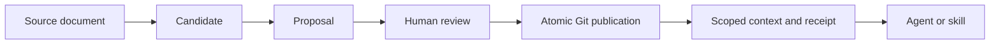

# Architecture

CCH supplies governed knowledge and reusable material to agents and skills.
The agent or skill owns task planning, writing, layout, and final documents.

| Component | Responsibility |
| --- | --- |
| CCH knowledge store | Approved knowledge, provenance, scope, versions, freshness |
| CCH source ingestion | Immutable source bytes, locators, quoted spans, candidate jobs |
| CCH asset index | Candidate visuals, descriptions, origin, lifecycle, retrieval |
| CCH evidence handoff | Frozen evidence packages, claim references, visual bindings, unresolved gaps, receipts |
| External agents, skills, models | Task reasoning, language/image understanding, writing, layout, PPT/Word generation |
| Optional Hindsight adapter | Explicit event submission and diagnostic recall; no fact authority |

## Controlled knowledge publication

Publication validates a complete temporary tree, records an approval-bound
transaction, and changes the approved Git ref using compare-and-swap. Readers
load one committed revision. Old proposals fail with `STALE_BASE` instead of
overwriting newer knowledge.

Approval does not automatically upgrade `TENTATIVE` or `AI_INFERRED` fields.
Formal approval, source currentness, and content confidence remain distinct.

## Material and evidence handoff

An asset is a candidate visual. Its filename, metadata, or similarity to a query
does not prove a current project fact. Model-produced descriptions are frozen
exchange results and remain subject to review.

The existing authoring subcommands coordinate externally produced plans and
evidence maps. They derive structured storyboards and verification receipts.
These are handoff data, not finished documents. CCH checks structure, references,
authority, hashes, and unresolved blockers. Humans still judge semantic support
and whether a visual actually matches its claim.

The public direction is to improve evidence supply and interoperability with
skills. A built-in PPT/Word rendering engine is outside CCH's scope.

## Optional memory

The adapter accepts explicitly constructed events, freezes them in a local
archive, sends them through an outbox, and supports diagnostic recall. Accepted
asynchronous submission is not proof that a memory was extracted or recalled.

Recall is currently separate from agent context. Unified context assembly and
promotion of memory into cognition proposals are not implemented. Provider
outage handling is locally tested with fake clients; a live provider still needs
its own storage, recovery, and operational qualification.
